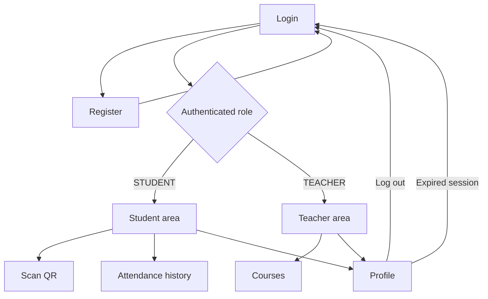
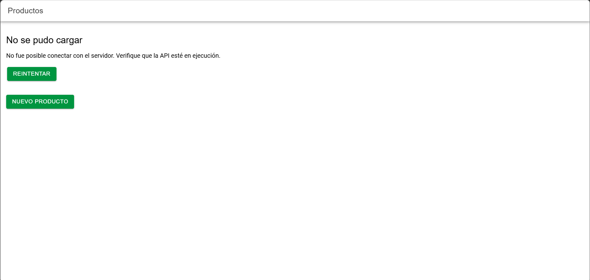
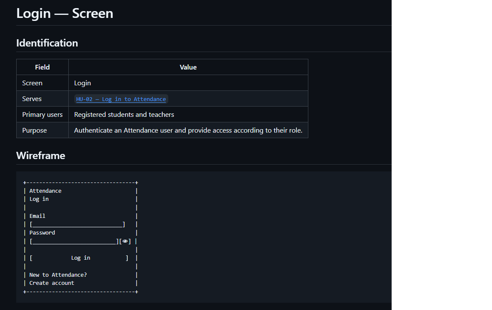
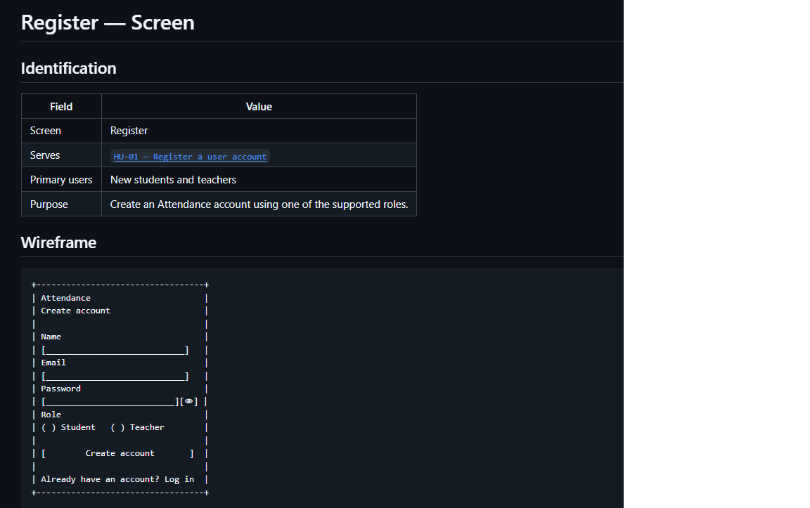
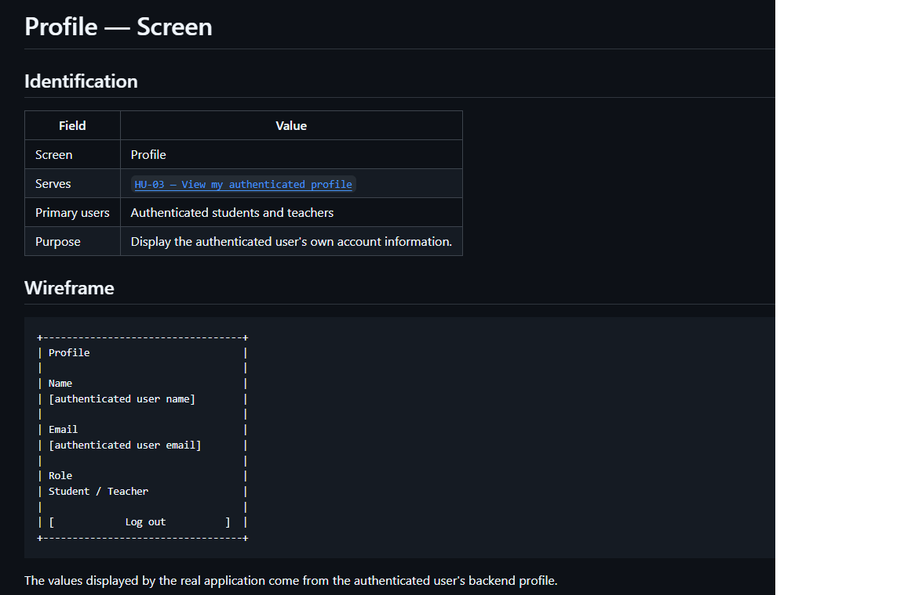

# CP1 — UX Audit

## Project

**Application:** Attendance Control  
**Workshop:** Week 11 — Advanced UX/UI  
**Focus:** User registration, authentication, and profile management  
**Technology:** Ionic React with TypeScript

## 1. Selected Screens

The UX review focuses on three screens documented in the Attendance Control project.

| Screen | Main purpose | Target users |
|---|---|---|
| Login | Authenticate an existing account using email and password. | Students and teachers |
| Register | Create a new account with the Student or Teacher role. | New users |
| Profile | Display the authenticated user's name, email, and role. | Authenticated users |

These screens are specified in the team's UX/UI documentation.

The current workshop application uses the official Ionic React starter, which initially contains a product catalog. Therefore, the Attendance Control screens are documented targets rather than existing executable screens.

## 2. UX Audit Findings

The findings below identify implementation gaps between the workshop starter and the documented Attendance Control experience.

They do not imply that the original team's wireframes lack these features. The documentation already specifies input validation, accessibility requirements, feedback states, and authentication behavior.

| Screen | Finding | UX principle | Severity | Proposed improvement |
|---|---|---|---|---|
| Login | The workshop app does not provide the documented login screen. | Navigation and task completion | High | Implement email and password authentication. |
| Login | Role-based access to Student and Teacher areas is not implemented in the starter. | Navigation consistency | High | Implement navigation according to the authenticated role. |
| Login | Authentication error feedback is unavailable because the login flow does not exist in the starter. | Error recovery | High | Provide clear validation and authentication messages. |
| Register | The starter does not include the documented account registration form. | Task completion | High | Implement fields for name, email, password, and role. |
| Register | Field validation and submission feedback are not available in the workshop application. | Error prevention | Medium | Implement inline validation, loading feedback, and server error messages. |
| Profile | Authenticated users cannot access their profile from the current starter. | Visibility of information | High | Display name, email, and user role. |
| Profile | The starter does not provide profile loading, error, or session-expiration handling. | Visibility of system status | High | Implement loading, retry, error, and expired-session states. |
| Profile | A logout action is not available in the current workshop application. | User control and freedom | High | Provide a visible logout button that clears the authenticated session. |

### Audit limitations

These findings describe differences between the starter and the intended Attendance Control experience.

The documented Login, Register, and Profile designs have not yet been implemented in the workshop application. Consequently, their actual contrast, touch-target dimensions, screen-reader behavior, and responsive layout cannot yet be verified through browser testing.

Those checks must be performed after the relevant screens are implemented.

## 3. Current Documented Navigation

The following diagram represents the navigation described in the team's documentation.

### Navigation analysis

Attendance Control defines different main destinations according to the authenticated user's role.

Students can access QR scanning, attendance history, and their profile. Teachers can access courses and their profile.

Both roles share the Profile screen.

The navigation structure is documented, but its actual usability cannot be confirmed until the workshop implementation is available and tested.

## 4. Initial Evidence

### Original Ionic React Starter

**Evidence:** Initial state of the workshop application before implementing the Attendance Control screens.

The image represents the official Ionic React starter, not the team's finished mobile application.

The starter contains a product catalog and serves as the technical baseline for the workshop.

### Attendance Control — Login

Original Login wireframe from the team's UX/UI documentation. It includes email, password, login action, and navigation to registration.

### Attendance Control — Register

Original Register wireframe showing name, email, password, role selection, and account creation.

### Attendance Control — Profile

Original Profile wireframe showing the authenticated user's name, email, role, and logout action.

These images represent documented wireframes, not implemented application screens.

### Documented Attendance Control Screens

The following screens are specified in the team's UX/UI repository:

- `12-ux-ui/login-screen.md`
- `12-ux-ui/register-screen.md`
- `12-ux-ui/profile-screen.md`

Each specification describes the screen purpose, wireframe, interaction states, validation or display rules, and accessibility considerations.

These documents are design references rather than screenshots of a working frontend.

## 5. Improvement Priorities

| Priority | Improvement | Reason |
|---|---|---|
| High | Implement Login and Register navigation. | Users need access to authentication and account creation. |
| High | Implement the Profile screen. | Students and teachers need to consult their account information. |
| High | Handle loading, error, and expired-session states. | Users need clear feedback when a request or session fails. |
| Medium | Apply consistent visual styles and navigation. | The screens should feel like parts of the same application. |
| Medium | Verify accessibility and responsive behavior. | The interface must support small screens and accessible interaction. |

## 6. Conclusion

The team's documentation defines the expected authentication and profile experience, including validation, user roles, session handling, and accessibility considerations.

The main challenge for this workshop is translating those documented requirements into a functional Ionic React interface.

The next improvements should preserve the project's domain terminology and provide consistent navigation, feedback, and visual hierarchy.

The original starter will remain the baseline for comparing the initial implementation with the adapted Attendance Control screens.
