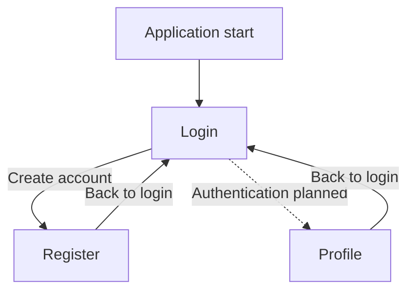

# CP2 — Navigation and Design Tokens

## Project Information

**Application:** Attendance Control  
**Workshop:** Week 11 — Advanced UX/UI  
**Focus:** Authentication and user profile  
**Technology:** Ionic React, React Router v5 and TypeScript

## 1. Navigation Pattern

The application uses stack-based navigation through Ionic React Router.

The authentication flow includes three screens:

- Login: `/login`
- Register: `/register`
- Profile: `/profile`

The root route redirects to Login.

### Navigation Diagram

The solid arrows represent implemented navigation. The dashed arrow represents authentication behavior that has not yet been implemented.

## 2. Design Tokens

The design tokens are defined in:

`app/src/app/theme/variables.css`

### Color Palette

| Token | Value | Purpose |
|---|---|---|
| Primary | `#007A35` | Main actions and primary buttons |
| Secondary | `#334155` | Secondary interface elements |
| Success | `#166534` | Successful operations |
| Danger | `#B42318` | Error messages |
| Background | `#FFFFFF` | Main application background |
| Text | `#1F2937` | Main text content |

The primary color is a darker institutional green, selected to improve readability with white text.

### Typography

| Token | Value | Usage |
|---|---|---|
| `--font-small` | `0.875rem` | Supporting text |
| `--font-body` | `1rem` | Regular content |
| `--font-heading` | `1.5rem` | Section headings |
| `--font-title` | `1.75rem` | Main page titles |

### Spacing

| Token | Value |
|---|---|
| `--space-xs` | `0.25rem` |
| `--space-sm` | `0.5rem` |
| `--space-md` | `1rem` |
| `--space-lg` | `1.5rem` |
| `--space-xl` | `2rem` |

## 3. Shared Layout

Authentication screens use the `.auth-container` CSS class.

This class provides:

- A maximum content width of 480px.
- Horizontal centering on wider screens.
- Consistent internal spacing.
- A minimum button height of 44px for buttons inside the container.

The layout is used by Login, Register, and Profile.

## 4. Implemented Screens

### Login

Provides email and password fields, basic required-field button disabling, and navigation to registration.

### Register

Provides name, email, password, and Student or Teacher role selection.

The Create account button is enabled when the required fields pass basic client-side checks.

### Profile

Provides the structure for displaying the authenticated user's name, email, and role.

Currently, the screen displays an unavailable-information message because backend authentication has not been connected.

## 5. Current Limitations

The application currently demonstrates navigation and interface design.

The following features are not implemented yet:

- Real authentication requests.
- Account creation through the backend.
- Protected routes and role-based access.
- Retrieval of the authenticated user's profile.
- Session management and logout.

These limitations must not be confused with completed backend functionality.

## 6. Accessibility and Responsive Design

The interface uses visible labels, Ionic components, and shared spacing tokens.

Responsive verification at 360px and 768px, keyboard navigation testing, and accessibility improvements will be documented in CP4.

## 7. Conclusion

The CP2 implementation introduces consistent navigation, shared design tokens, and a common layout for the authentication and profile screens.

These changes establish the visual foundation for the Attendance Control interface while keeping unfinished authentication features clearly identified.
