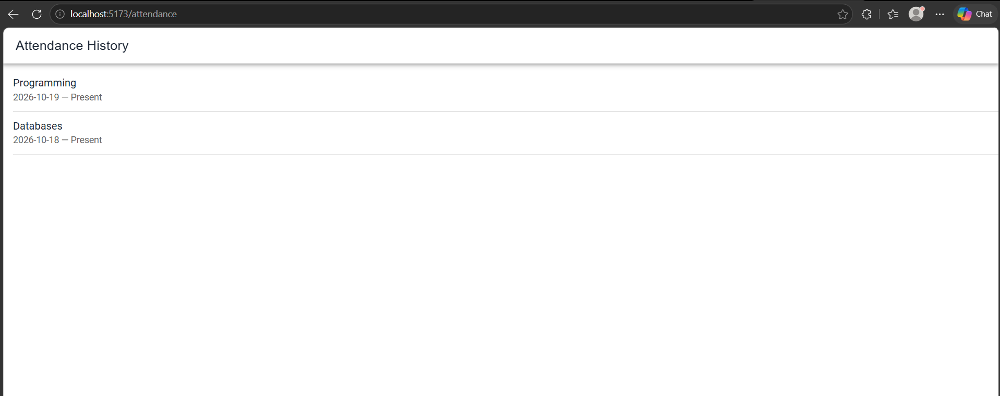
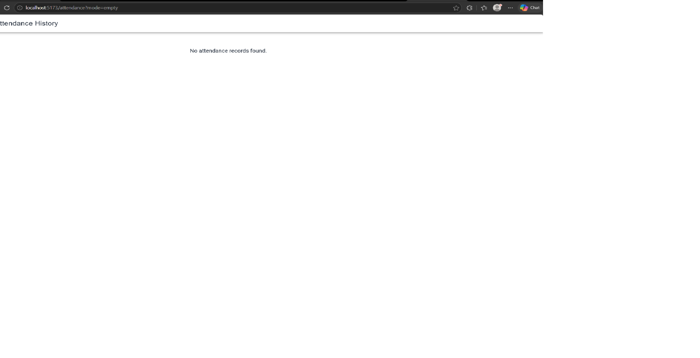
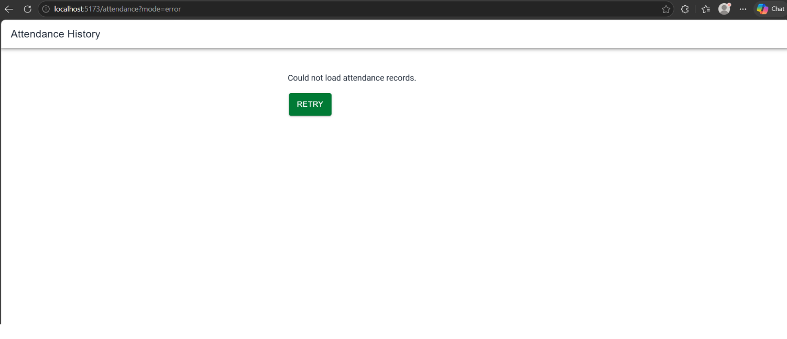

# CP3 — Attendance List States

## 1. Screen

- Application: Attendance Control
- Screen: Attendance History
- Route: `/attendance`
- Component: `AttendanceListPage.tsx`

## 2. Implemented States

| State | Behavior |
|---|---|
| Loading | Displays animated Ionic skeleton placeholders. |
| Data | Displays attendance records in an IonList. |
| Empty | Displays "No attendance records found." |
| Error | Displays an error message and a Retry button. |

## 3. State Simulation

The screen currently uses mock data because it is not
connected to the Attendance Control backend.

- Data: `/attendance`
- Empty: `/attendance?mode=empty`
- Error: `/attendance?mode=error`

The Retry button triggers another loading attempt.
The simulated error persists while `mode=error` is active.

An IonRefresher is implemented to reload the records
when the user pulls down the list.

## 4. Automated Test

Test file:
`src/features/attendance/presentation/__tests__/AttendanceListPage.test.tsx`

Command:

`npx vitest run src/features/attendance/presentation/__tests__/AttendanceListPage.test.tsx`

Verified result:

- Test files: 1 passed
- Tests: 1 passed

The test checks the error message, the Retry button,
and the loading state after clicking Retry.

## 5. Evidence

The following screenshots show the three verified
states of the Attendance History screen.

### Data state

### Empty state

### Error state

## 6. Current Limitations

- Attendance records are simulated.
- Backend integration remains pending.
- The automated test does not verify a successful
  recovery after a network failure.
- Pull-to-refresh still needs manual verification.
