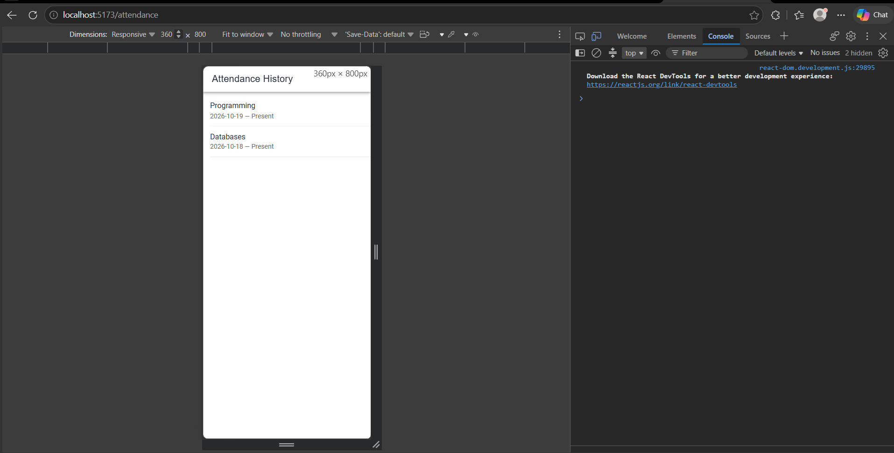
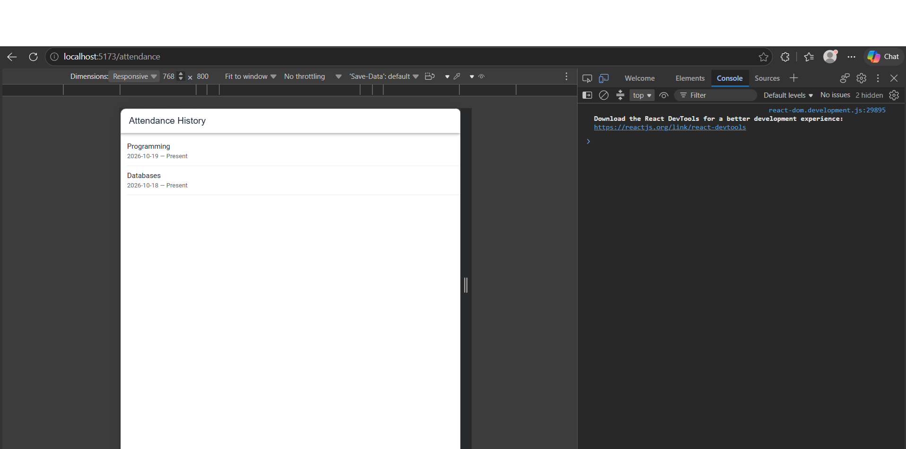
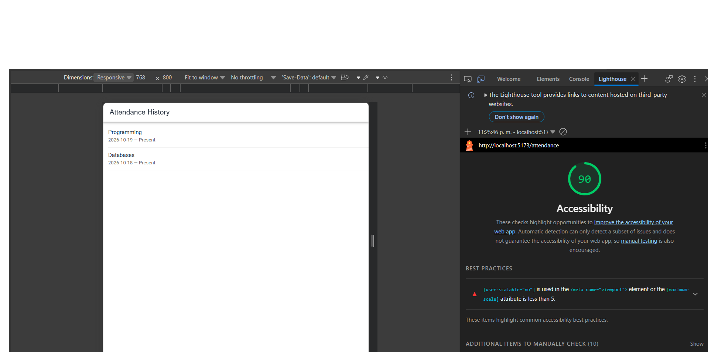
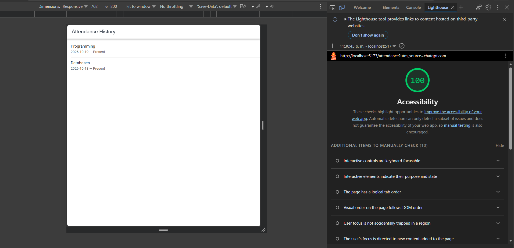

# CP4 — Accessibility and Responsive Design

## 1. Screen Evaluated

- Application: Attendance Control
- Screen: Attendance History
- Route: `/attendance`
- Technology: Ionic React and TypeScript

## 2. Responsive Design

The screen was reviewed using the browser's device
emulation tools at two viewport sizes.

| Viewport | Result |
|---|---|
| 360 × 800 px | Title and attendance records are visible. No horizontal overflow was observed. |
| 768 × 800 px | Content adapts correctly. No horizontal overflow was observed. |

### Evidence

**Mobile — 360 px**



**Tablet — 768 px**



## 3. Accessibility Improvement

The initial Lighthouse accessibility audit identified
a problem with the viewport configuration.

The original `index.html` contained:

- `maximum-scale=1.0`
- `user-scalable=no`

These settings restricted the user's ability to zoom
into the application.

The viewport configuration was updated to:

```html
<meta
  name="viewport"
  content="viewport-fit=cover, width=device-width, initial-scale=1.0"
/>
```

The page title was also updated to `Attendance Control`,
and the color scheme was set to light.

## 4. Lighthouse Results

| Audit | Accessibility score |
|---|---|
| Before | 90/100 |
| After | 100/100 |
| Improvement | +10 points |

Both audits were performed with Lighthouse using
the Mobile device setting.

### Evidence

**Before**



**After**



## 5. Accessibility Considerations

- Users can zoom into the page.
- Attendance records are displayed using Ionic components.
- The error state includes a visible Retry button.
- The error message uses `role="alert"`.
- Responsive layouts were reviewed at 360 px and 768 px.

## 6. Limitations

- Lighthouse automated checks do not guarantee complete accessibility.
- Keyboard navigation and screen-reader behavior require additional manual testing.
- Attendance data is currently simulated.
- Backend integration is still pending.
