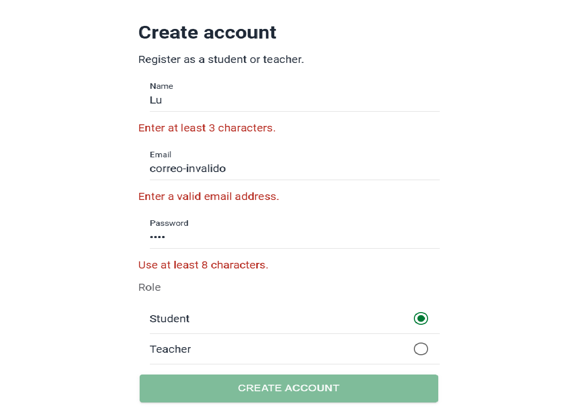
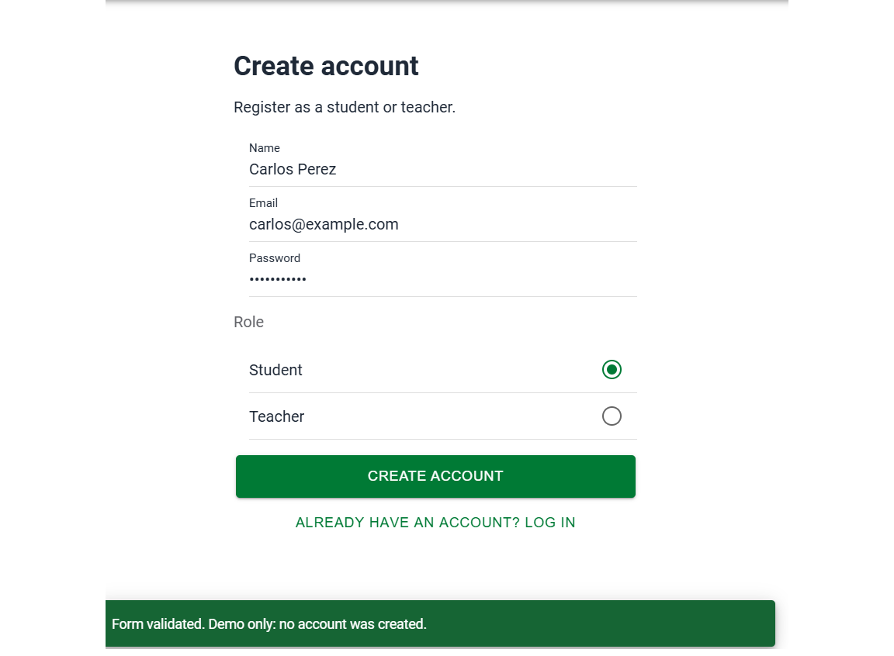
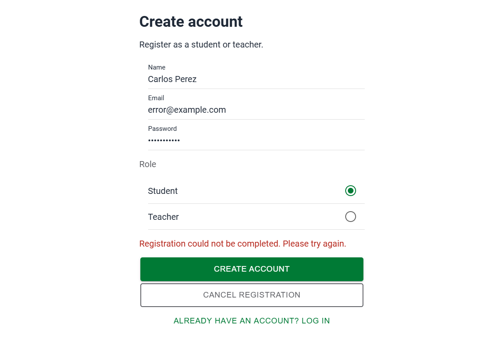
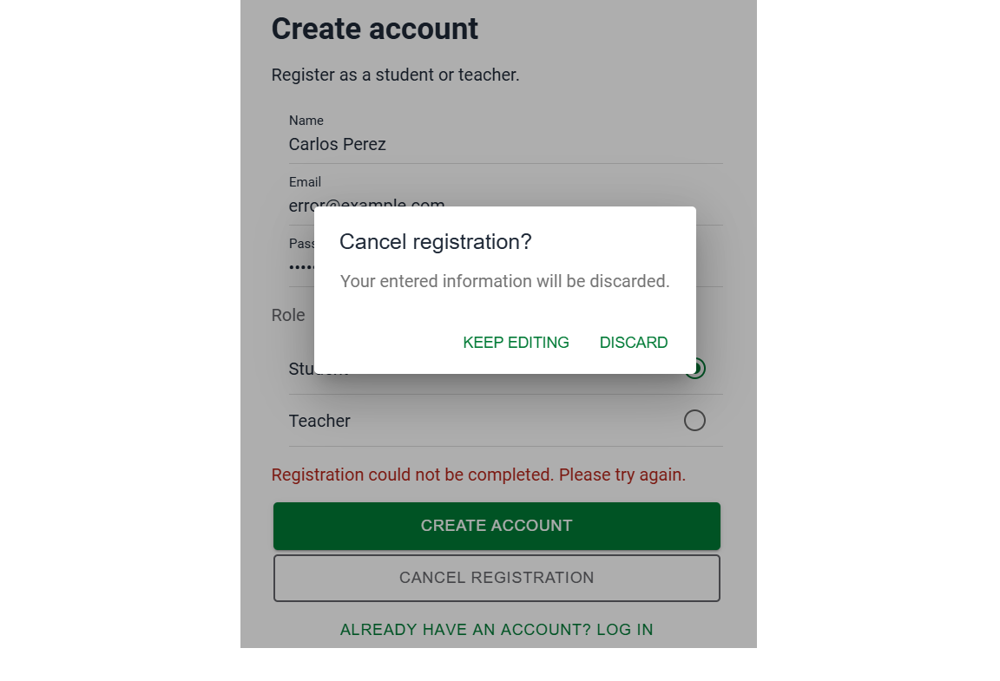

# CP6 — Registration Form Validation and Feedback

## 1. Screen

- Application: Attendance Control
- Screen: Create Account
- Route: `/register`
- Component: `RegisterPage.tsx`
- User roles: STUDENT and TEACHER

## 2. Validation Rules

| Field | Validation | Purpose |
|---|---|---|
| Name | Minimum 3 characters | Prevent incomplete user names |
| Email | Valid email format | Require a usable account identifier |
| Password | Minimum 8 characters | Enforce a basic password length |
| Role | STUDENT or TEACHER | Identify the user's role |

The Create Account button is disabled when the form is
invalid or when a submission is in progress.

Validation messages appear below invalid fields.

## 3. User Feedback

- Loading: IonLoading is displayed during submission.
- Success: IonToast confirms that local validation passed.
- Error: A message appears when a simulated request fails.
- Cancel: IonAlert asks for confirmation before discarding data.

## 4. Test Scenarios

### Invalid fields

Use a short name, invalid email and short password.

### Valid form

Complete all fields using valid test data.

### Simulated submission error

Use `error@example.com` as the email address.

### Cancel confirmation

Select Cancel Registration after entering information.

## 5. Current Limitations

- Registration is a local UI simulation.
- No account is created in the backend.
- The email `error@example.com` triggers a simulated error.
- Real server validation and error responses are pending.
