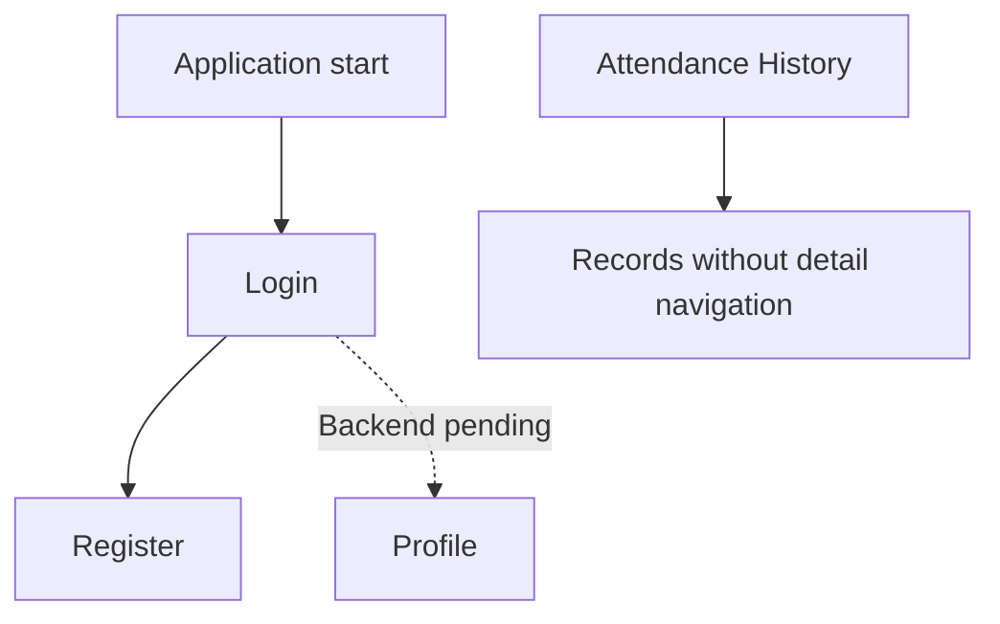
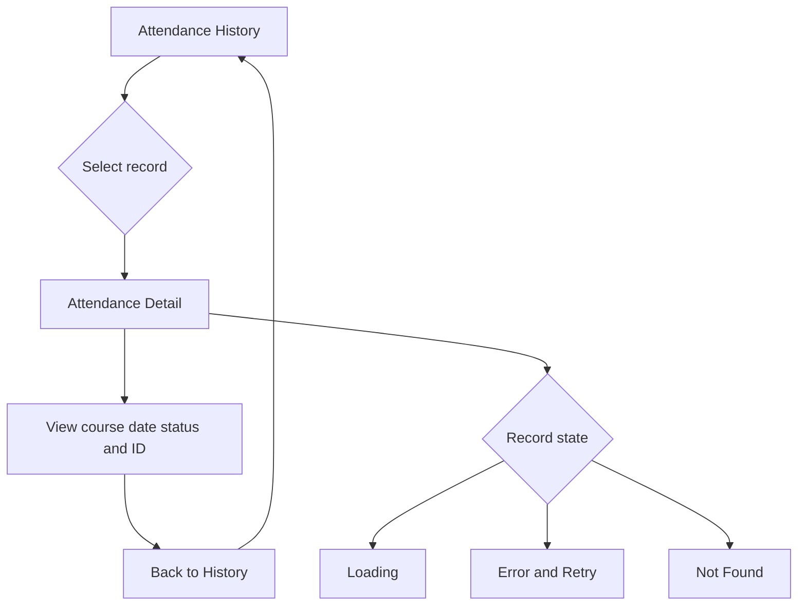
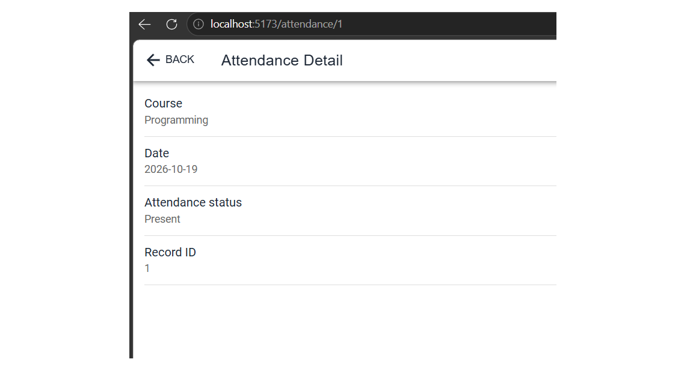
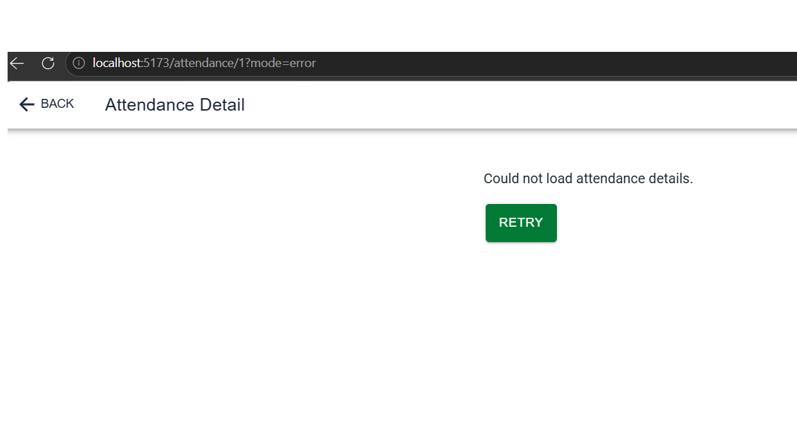
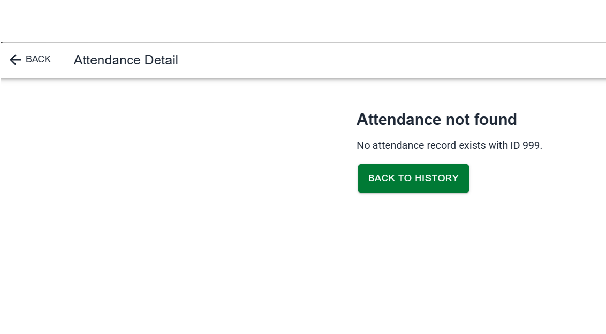

# CP7 — Attendance Detail and Navigation Flow

## 1. Objective

Extend the Attendance Control history screen with
navigation to individual attendance records.

The detail screen receives the attendance record ID
through the URL and displays its information.

## 2. Implemented Routes

| Route | Screen |
|---|---|
| `/login` | Login |
| `/register` | Registration |
| `/profile` | User profile |
| `/attendance` | Attendance history |
| `/attendance/:id` | Attendance detail |

## 3. Previous Navigation

During the initial UX audit, the official starter
did not provide an Attendance Control navigation flow.

The attendance history screen was not connected to
a dedicated detail page.

## 4. Updated Navigation

The attendance list now allows users to select
a record and open its detail page.

## 5. Detail Screen

Component: `AttendanceDetailPage.tsx`

The screen receives an `id` parameter using React Router.

For the simulated record with ID 1, it displays:

- Course: Programming
- Date: 2026-10-19
- Attendance status: Present
- Record ID: 1

The Back button returns to Attendance History.

### Evidence

## 6. Detail States

### Loading

An Ionic skeleton is shown while the record loads.

### Error

A simulated loading error can be tested at:

`/attendance/1?mode=error`

The screen shows an error message and Retry button.

### Not Found

An unknown record ID can be tested at:

`/attendance/999`

The screen shows an Attendance not found message
and a button to return to the history.

## 7. UX Improvements

Before CP7, attendance records were displayed
without direct access to a detail screen.

After CP7, users can open a record directly
by selecting it in the history list.

This reduces navigation effort because users
do not need to search for a separate detail page.

The detail page also provides clear feedback
for loading errors and missing records.

## 8. Current Limitations

- Attendance records are simulated.
- The detail screen does not request data from the backend.
- Authentication and role-based access are not connected.
- Retry repeats the simulated request.
- Backend integration and real attendance history remain pending.
