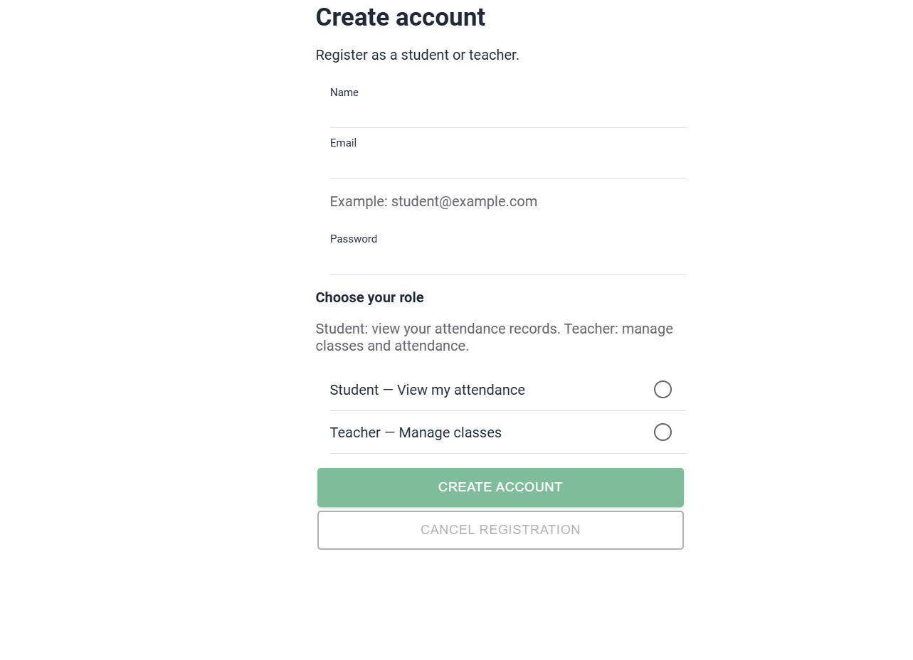
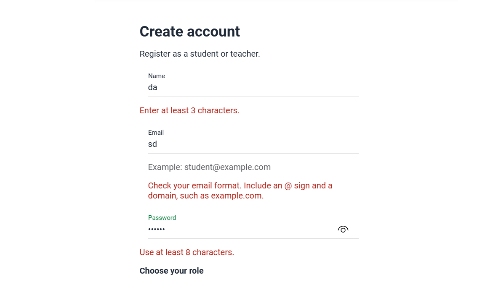

# CP9 — Before and After: UX/UI Improvements

## 1. Project Information

- Application: Attendance Control
- Technology: Ionic React and TypeScript
- Checkpoint: CP9 — Before/After and User Stories
- Main screens: Registration and Attendance History

## 2. Objective

Document the evolution of the Attendance Control interface and explain how the improvements introduced during the workshop address usability, navigation, validation, and accessibility.

The comparisons use existing screenshots and documentation from previous checkpoints.

## 3. Comparison 1 — Registration Screen

### Before

The initial registration design was documented as a wireframe with Name, Email, Password, and Student/Teacher role selection.

The wireframe showed the basic form structure without detailed role descriptions or visible validation feedback.


### After

The implemented registration screen includes:

- Validation for name, email, and password.
- A sample email address.
- Clear descriptions of Student and Teacher roles.
- Specific error messages.
- Loading and confirmation feedback.
- A confirmation dialog when cancelling.



### Improvement

The registration flow provides more guidance and makes the role options easier to understand.

The before image is a documented wireframe, not a screenshot of a running application.

## 4. Comparison 2 — Email Validation

### Before

The initial registration wireframe did not show an email validation message.


### After

The implemented form displays an example email address and a message that explains the required email format when an invalid value is entered.



### Improvement

The feedback is more actionable because users receive instructions about the @ sign and domain rather than only a generic invalid-email warning.

This improvement was motivated by the observations recorded during CP8.

## 5. Comparison 3 — Attendance Navigation

### Before

The attendance history displayed records with their course names, dates, and attendance status.

The screenshot shows the initial list layout at a viewport size of 360 x 800 pixels.


### After

Users can select an attendance record and open a dedicated details screen.

The detail page displays:

- Course name
- Date
- Attendance status
- Record ID
- Back navigation


### Improvement

The application now supports navigation from the attendance list to an individual record and back to the history.

These images compare two stages of a navigation flow, not two versions of the same screen.

## 6. User Stories

### US-01 — Clear Registration Role Selection

**As a** new user,  
**I want** to understand the available account roles,  
**so that** I can choose the role that matches my needs.

**Acceptance criteria:**

- [x] The registration page displays Student and Teacher.
- [x] Each role includes a short explanation.
- [x] Only one role can be selected at a time.
- [x] The form requires a role before submission.

**Evidence:**


### US-02 — Helpful Email Validation

**As a** user completing the registration form,  
**I want** to understand why my email is invalid,  
**so that** I can correct it without guessing.

**Acceptance criteria:**

- [x] The form displays an example email address.
- [x] Invalid email input displays an error message.
- [x] The error explains the required email format.
- [x] Submission remains disabled while invalid.
- [x] The error disappears when the email is corrected.

**Evidence:**


### US-03 — Attendance Record Details

**As a** student,  
**I want** to open an attendance record,  
**so that** I can review its information.

**Acceptance criteria:**

- [x] The attendance history displays records.
- [x] Selecting a record opens its detail route.
- [x] The detail displays course, date, status, and ID.
- [x] A Back control returns to the history.
- [x] An unknown record displays a not-found state.
- [x] A simulated loading failure displays an error state.

**Evidence:**


**Additional evidence — Not-found state:**


**Additional evidence — Error state:**


## 7. Technical Verification

The application was built successfully using:

```bash
npm run build
```

The CP7 and CP8 implementations passed TypeScript compilation and Vite production builds.

The CP8 implementation modified `RegisterPage.tsx` with 25 added lines and 4 removed lines.

The workshop improvements were verified through:

- Visual inspection of the registration form.
- Validation of invalid email feedback.
- Navigation from attendance history to record details.
- Verification of error and not-found states.
- Production build execution.
- Screenshots stored in the `docs/img` directory.

## 8. Limitations

- Registration is currently a demonstration flow.
- Attendance records are currently simulated data.
- The application is not yet connected to the production authentication and attendance APIs.
- The usability improvements have not been evaluated through a documented follow-up test.
- Before and after screenshots represent different development stages and must be interpreted in that context.

## 9. Conclusion

The workshop improved the registration experience, form feedback, and attendance navigation.

The resulting interface provides clearer instructions, more useful validation messages, and a dedicated attendance details screen.

The next development stage should integrate these interfaces with the real backend while preserving their usability and accessibility.
