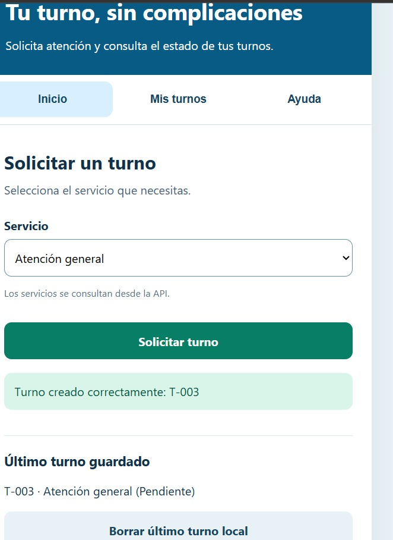
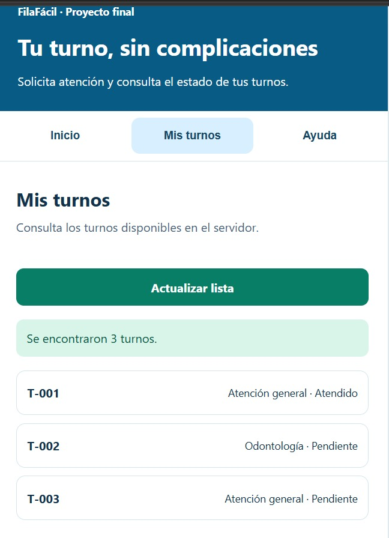
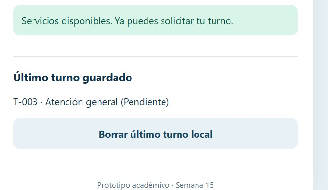
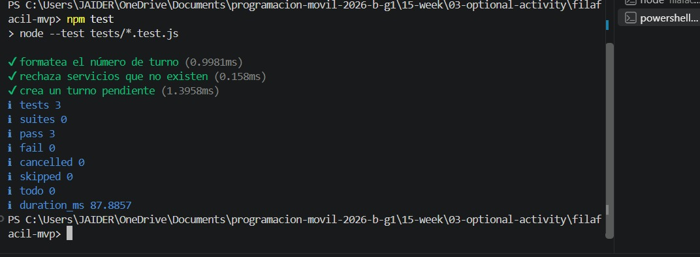

# FilaFácil – Semana 15: Avance del proyecto final

**Asignatura:** Programación Móvil  
**Programa:** Ingeniería de Sistemas  
**Universidad:** CORHUILA  
**Periodo:** 2026-B  
**Actividad:** Semana 15 – Corte 3  
**Modalidad:** Actividad opcional

## 1. Descripción del proyecto

FilaFácil es una aplicación desarrollada para facilitar la organización y consulta de turnos de atención en diferentes establecimientos.

La idea surge de la necesidad de mejorar la manera en que las personas solicitan sus turnos, evitando confusiones y permitiendo consultar su información de forma sencilla.

Durante la Semana 15 se desarrolló un MVP (Producto Mínimo Viable), integrando las principales funcionalidades de la aplicación.

Este avance permite solicitar turnos, consultar sus estados y guardar localmente la información del último turno solicitado.

## 2. Problema identificado

En muchos establecimientos, las personas deben esperar su turno sin conocer claramente cuándo serán atendidas.

Esta situación puede generar desorganización, pérdida de tiempo y dificultades tanto para los usuarios como para los encargados de prestar el servicio.

FilaFácil busca ofrecer una solución digital sencilla para que los usuarios puedan solicitar y consultar turnos desde una interfaz fácil de utilizar.

## 3. Objetivo general

Desarrollar un MVP funcional de FilaFácil que permita solicitar y consultar turnos mediante una API, incorporando navegación entre pantallas, manejo de errores y almacenamiento local.

### Objetivos específicos

- Implementar una pantalla para solicitar turnos.
- Consultar los servicios disponibles mediante una API.
- Mostrar una lista con los turnos registrados.
- Implementar navegación entre las pantallas.
- Manejar los estados de carga y error.
- Guardar el último turno utilizando almacenamiento local.
- Realizar pruebas para verificar el funcionamiento de las principales funciones.

## 4. Tecnologías utilizadas

| Tecnología | Uso y justificación |
|---|---|
| HTML5 | Permite crear la estructura de las pantallas de la aplicación. |
| CSS3 | Se utiliza para diseñar una interfaz sencilla y adaptable a dispositivos móviles. |
| JavaScript | Permite implementar la navegación, las peticiones y el funcionamiento de los botones. |
| Node.js | Se utiliza para ejecutar el servidor y las pruebas unitarias. |
| API REST | Permite conectar la interfaz con el servidor para consultar y registrar turnos. |
| LocalStorage | Permite guardar el último turno solicitado para recuperarlo después de actualizar la página. |

Estas tecnologías se eligieron porque permiten desarrollar un prototipo funcional de forma sencilla, utilizando herramientas conocidas durante el curso de Programación Móvil.

## 5. Funcionalidades implementadas

### 5.1. Solicitud de turnos

Desde la pantalla principal, el usuario puede seleccionar un servicio disponible y solicitar un turno.

Cuando se presiona el botón **Solicitar turno**, la aplicación envía una petición a la API y recibe la información correspondiente.

### 5.2. Consulta de turnos

La sección **Mis turnos** permite visualizar los registros que se encuentran en el servidor.

Cada turno muestra su número, el servicio solicitado y su estado de atención.

Durante las pruebas se visualizaron los siguientes registros:

| Turno | Servicio | Estado |
|---|---|---|
| T-001 | Atención general | Atendido |
| T-002 | Odontología | Pendiente |
| T-003 | Atención general | Pendiente |

### 5.3. Navegación

La aplicación cuenta con tres secciones principales:

- **Inicio:** permite seleccionar un servicio, solicitar un turno y consultar el último turno guardado.
- **Mis turnos:** muestra los turnos registrados en el servidor.
- **Ayuda:** presenta información básica sobre el funcionamiento de la aplicación.

### 5.4. Conectividad con la API

FilaFácil utiliza peticiones HTTP para comunicarse con el servidor.

La aplicación permite:

- Consultar los servicios disponibles.
- Solicitar nuevos turnos.
- Consultar los turnos registrados.
- Mostrar mensajes mientras se realizan las peticiones.
- Informar al usuario cuando ocurre un error de conexión.

### 5.5. Almacenamiento local

Se implementó `localStorage` para conservar la información del último turno solicitado.

Durante las pruebas se guardó el siguiente registro:

**Turno:** T-003  
**Servicio:** Atención general  
**Estado:** Pendiente

La aplicación también incluye el botón **Borrar último turno local**, que permite eliminar esta información del navegador.

## 6. Flujo principal del MVP

El funcionamiento de la aplicación se desarrolla de la siguiente manera:

1. El usuario abre FilaFácil.
2. La aplicación consulta los servicios disponibles desde la API.
3. El usuario selecciona el servicio que necesita.
4. Presiona el botón **Solicitar turno**.
5. La aplicación envía la solicitud al servidor.
6. El servidor registra el turno y devuelve la información.
7. La aplicación muestra el número correspondiente.
8. La información del último turno se guarda mediante `localStorage`.
9. El usuario ingresa a **Mis turnos**.
10. La aplicación consulta los registros y muestra los turnos disponibles.

Este flujo representa la funcionalidad principal del MVP.

## 7. Cómo ejecutar el proyecto

Para ejecutar FilaFácil es necesario tener instalado Node.js.

### Pasos

1. Abrir Visual Studio Code.
2. Abrir la carpeta `filafacil-mvp`.
3. Abrir una terminal.
4. Ejecutar:

```bash
npm start
```

5. Abrir el navegador e ingresar a:

`http://localhost:3000`

6. Probar la solicitud y consulta de turnos.

Para detener el servidor se utiliza `Ctrl + C`.

## 8. Pruebas y verificación

Durante el desarrollo de FilaFácil se realizaron pruebas funcionales y unitarias para comprobar el comportamiento de la aplicación.

### 8.1. Pruebas funcionales

| Funcionalidad | Resultado |
|---|---|
| Pantalla principal | Funciona correctamente |
| Consulta de servicios desde la API | Funciona |
| Solicitud de turnos | Funciona |
| Consulta de turnos | Funciona |
| Navegación entre pantallas | Funciona |
| Almacenamiento local | Funciona |

### 8.2. Pruebas unitarias

Para ejecutar las pruebas unitarias se utilizó el comando:

```bash
npm test
```

Se realizaron tres pruebas:

**Prueba 1: Formatear el número de turno**

Comprueba que los números de turno se presenten con el formato correspondiente.

**Prueba 2: Rechazar servicios que no existen**

Verifica que el sistema rechace solicitudes cuando el servicio seleccionado no es válido.

**Prueba 3: Crear un turno pendiente**

Comprueba que un nuevo turno se registre con el estado pendiente.

### 8.3. Resultados obtenidos

Las tres pruebas se ejecutaron correctamente desde la terminal de Visual Studio Code.

| Resultado | Cantidad |
|---|---:|
| Pruebas ejecutadas | 3 |
| Pruebas aprobadas | 3 |
| Pruebas fallidas | 0 |
| Pruebas canceladas | 0 |
| Pruebas omitidas | 0 |
| Duración total | 87.8857 ms |

**Conclusión de las pruebas:**

Las tres pruebas unitarias finalizaron satisfactoriamente y no se presentaron errores.

Estos resultados permiten comprobar que las funciones evaluadas cumplen con el comportamiento esperado.

## 9. Evidencias del funcionamiento

Las evidencias se encuentran en la carpeta `evidencias/`.

### Evidencia 1. Solicitud de turno

**Archivo:** `01-turno-solicitado.jpg`

Muestra el resultado de solicitar un turno desde la pantalla principal de FilaFácil.



### Evidencia 2. Lista de turnos

**Archivo:** `02-lista-turnos.jpg`

Muestra los registros consultados desde la API, incluyendo los números de turno, servicios y estados de atención.



### Evidencia 3. Almacenamiento local

**Archivo:** `03-almacenamiento-local.jpg`

Muestra el último turno guardado utilizando `localStorage`.



### Evidencia 4. Pruebas unitarias

**Archivo:** `04-pruebas-unitarias.jpg`

Muestra la ejecución de `npm test`, con tres pruebas aprobadas y ninguna fallida.



## 10. Mejoras futuras

Para las siguientes versiones del proyecto se propone:

- Implementar notificaciones cuando se acerque el turno.
- Mostrar la cantidad de personas que se encuentran antes del usuario.
- Incorporar un sistema de inicio de sesión.
- Agregar opciones para cancelar turnos.
- Implementar una aplicación Android mediante Capacitor.
- Incorporar funciones administrativas para gestionar la atención.

Estas mejoras permitirían ampliar el funcionamiento del MVP.

## 11. Conclusión

Durante la Semana 15 se logró avanzar en el desarrollo del proyecto final FilaFácil mediante la integración de sus principales funcionalidades.

Se implementó la solicitud y consulta de turnos utilizando una API, además de navegación entre pantallas y almacenamiento local para conservar información.

También se realizaron tres pruebas unitarias, todas aprobadas, lo que permitió verificar el comportamiento de las funciones evaluadas.

Esta actividad permitió aplicar conocimientos adquiridos durante el curso de Programación Móvil y comprender la importancia de integrar diferentes componentes para construir una aplicación funcional.

## 12. Observaciones

Los datos utilizados son de demostración y el servidor se ejecuta localmente.

FilaFácil es un prototipo web adaptable a dispositivos móviles, desarrollado con HTML, CSS, JavaScript y Node.js. No constituye todavía una aplicación Android nativa.

El proyecto se presenta como avance del MVP para la actividad opcional de la Semana 15 de Programación Móvil.